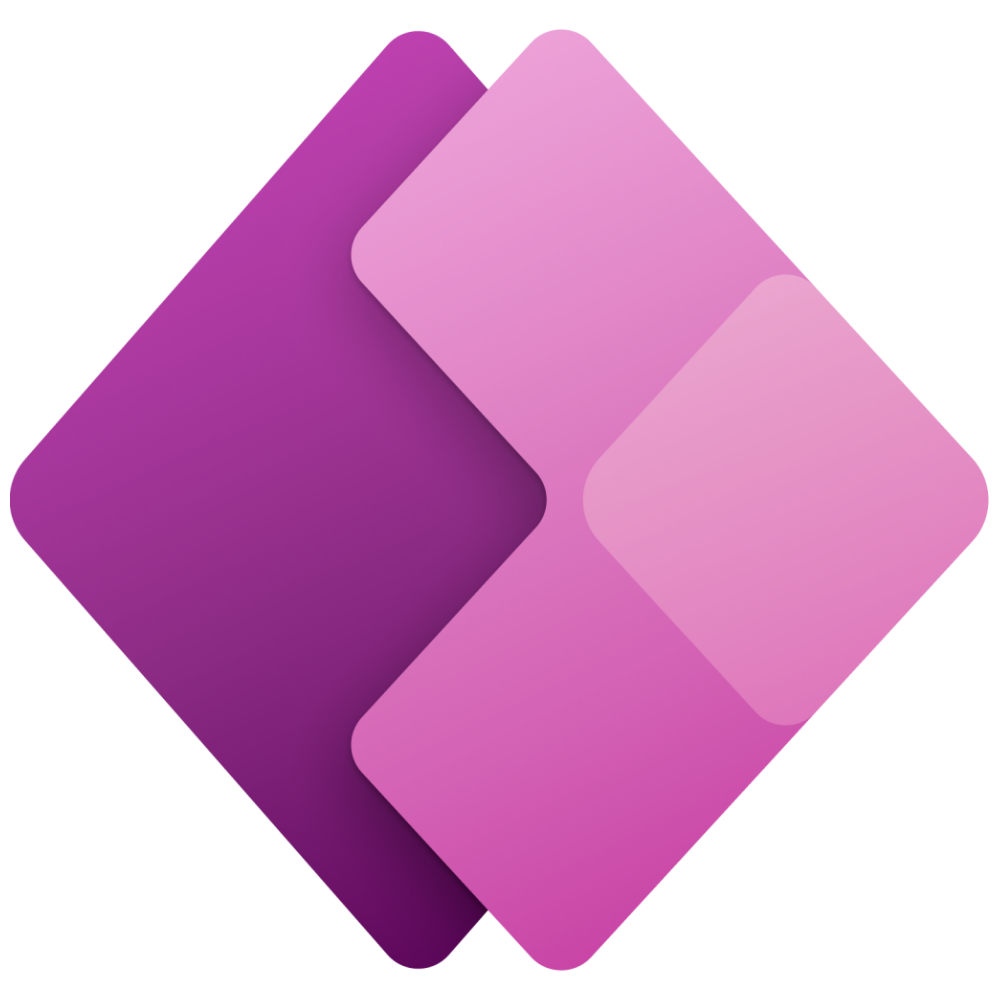
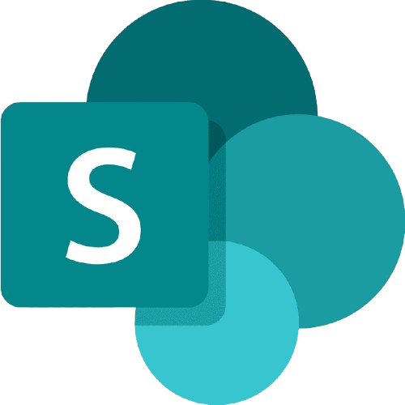

<!--horizontal divider (gradient)-->

<h1 align="center">
  
</h1>

  <h3>Full-stack developer junior. Construyo apps end-to-end: UI → lógica → datos → despliegue.</h3>
  
📍 Sevilla, España · 🎓 DAM · 🧩 Java/Spring Boot · JavaScript · SQL · 🤖 IA & automatización

<!-- CTA BUTTONS (table layout = spacing works in GitHub) -->

  <table border="0" cellpadding="0" cellspacing="0"
         style="border:none;border-collapse:collapse;">
    <tr>
      <td align="center" valign="top" style="border:none;">
         
        
      </td>

  <td width="40" style="border:none;"></td>

  <td align="center" valign="top" style="border:none;">
         
        
      </td>

  <td width="40" style="border:none;"></td>

  <td align="center" valign="top" style="border:none;">
         
        
      </td>
    </tr>
  </table>

---

<h2>Stack</h2>

  <table border="0" cellpadding="12" cellspacing="0"
         style="border:none;border-collapse:collapse;">
    <tr>
      <td width="420" valign="top" align="center" style="border:none;">

  <h3>Web (Frontend)</h3>
        
          

  <h3>Backend / Scripting</h3>
        
          

  <h3>Bases de datos</h3>
        
          

  <h3>Tools</h3>
        

  </td>

  <td width="60" style="border:none;"></td>

  <td width="420" valign="top" align="center" style="border:none;">

  <h3>Mobile (Android)</h3>
        
          

  <h3>Desktop (.NET)</h3>
        
          

  <h3>Microsoft / Low-code / BI</h3>
        
        &nbsp;&nbsp;&nbsp;
        
        &nbsp;&nbsp;&nbsp;
        
        &nbsp;&nbsp;&nbsp;
        

  </td>
  </tr>
  </table>

---

## Stats

  

<!--horizontal divider (gradient)-->

